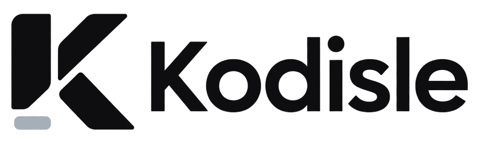

<p align="center">
  <picture>
    <source media="(prefers-color-scheme: dark)" srcset="docs/brand/wordmark-dark.png">
    
  </picture>
</p>

**Your dev environment at a glance — in the notch, the dock and the menu bar.**

Kodisle is a free, open-source macOS app for developers. It shows the things you check a hundred
times a day — AI plan limits, running dev servers, CI, pull requests, endpoints, agents — where
you can see them without opening anything: a dynamic island around the notch, a custom dock with
live widget tiles, and a menu bar panel.

> Native SwiftUI + Liquid Glass · macOS 26+ · no accounts, no telemetry, no tokens stored.

## Surfaces

| Surface | What it does |
| --- | --- |
| **Dynamic island** | Lives around the notch (or a pill on screens without one). The left glyph is your pick (e.g. Claude 5h %); the right one automatically shows what's active — approvals, focus timer, agents, deploys, CI, dev servers — rotating when several are. Hover to expand into tabs; live activities pop up when something happens. |
| **Kodisle dock** *(opt-in)* | Replaces the macOS Dock: your pinned and running apps, live widget tiles with paging, a Downloads stack and the Trash. Click a tile for its full panel. |
| **Menu bar** | Every widget in a compact panel. Shows your current AI usage next to the icon. |
| **Dock badge** | If you keep the macOS Dock, Kodisle can live there with a badge counting failing CI, review requests, endpoints down and agents waiting. |

## Widgets

- **AI usage**: Claude Code and Codex **5-hour and weekly plan limits**, the same numbers as `/usage`, with reset countdowns. Alerts at 80% / 95%.
- **Agents**: live Claude Code / Codex sessions with their titles: *working*, *waiting for you*, *done*. When an agent finishes, the island shows the session title and a one-line summary of what it did.
- **Dev servers**: every port you're listening on from a project folder, with framework detection (Next.js, Vite, Astro…), uptime, open / copy / reveal / stop.
- **GitHub**: your open PRs with check status, review requests, recent Actions runs in the repos you're working on, unread notifications.
- **Git**: the most recently active local repos: branch, ahead/behind, uncommitted changes.
- **Endpoints**: HTTP health checks with latency sparklines; the island alerts when one goes down or recovers.
- **Docker**: containers with start / stop / restart (Docker Desktop, OrbStack, Colima).
- **System**: CPU, memory, disk, battery.
- **Vercel**: latest deployments across your personal account and teams; the island tells you when a deploy is ready or fails.
- **Clipboard history**: everything you copy, searchable, in memory only. Password-manager copies are never recorded and tokens are masked and auto-removed.
- **Generator**: random or memorable passwords with strength meter, UUIDs, numbers, lorem ipsum.
- **Downloads**: searchable, grouped by day, with thumbnails; drag files out.
- **Focus timer** and **Calculator**.

## Integrations (opt-in, Settings › Integrations)

- **Approve Claude Code permissions from the island.** A `PermissionRequest` hook forwards each request to the island, which shows the command with *Allow*, *Always allow* or *Deny*. If Kodisle isn't running, Claude Code asks in the terminal as usual.
- **Long terminal commands.** A zsh hook notifies the island when a command that ran ≥ 15 s finishes, with ✓/✗ and duration. Only the program and subcommand are sent (`pnpm build`), never arguments.

Both talk to Kodisle through a local Unix socket (`~/.kodisle/bridge.sock`, owner-only) and back up any file they modify.

## Install

Requires macOS 26 (Tahoe) or later. Universal app (Apple Silicon and Intel).

**Homebrew**

```sh
brew install --cask pablorod1/tap/kodisle
```

**One-line installer** (downloads the latest release, verifies its SHA-256 and installs to `/Applications`; [read it first](install.sh))

```sh
curl -fsSL https://raw.githubusercontent.com/pablorod1/kodisle/main/install.sh | sh
```

**Manual**: download `Kodisle.zip` from [Releases](https://github.com/pablorod1/kodisle/releases). The app isn't notarized yet, so macOS will
ask you to allow it in *System Settings › Privacy & Security › Open Anyway* (Homebrew and the installer avoid this).

**Updates**: Kodisle checks GitHub Releases once a day and can update itself from *Settings › General* (or `brew upgrade`).

**From source**: `brew install xcodegen && ./scripts/build-release.sh`, or `xcodegen generate && open Kodisle.xcodeproj`.

### Optional setup

- **GitHub**: `brew install gh && gh auth login`. Kodisle uses the `gh` CLI and never sees your token.
- **Claude Code / Codex**: just be signed in to the CLIs. Kodisle detects them.
- **Projects folder**: defaults to `~/Dev`; change it in *Settings › Sources*.

## Privacy & security

Kodisle was designed to be safe to publish and to run on a work machine. See [SECURITY.md](SECURITY.md) for details.

- **No tokens are ever stored.** GitHub goes through `gh`. Claude Code / Codex access tokens are read on demand from the CLI's own credential store, used for a single request and dropped. They are **never refreshed**, so Kodisle can't sign your CLI out.
- **No environment leakage.** Child processes (`git`, `gh`, `lsof`, `docker`) run with a minimal environment, so secrets exported in your shell never reach them.
- **No command lines.** Dev servers are identified by process name, port and folder; arguments (which often contain tokens) are never read.
- **Minimal transcript access.** The Agents widget reads timestamps, `cwd`, message types and the session title. Task summaries in notifications come from the agent's last reply only; they stay in memory and can be turned off in *Settings › Privacy*.
- **Safe on screen.** URLs are shown without credentials or query strings, and *Privacy mode* blurs project names, repos and titles for screen sharing.
- **Passwords** copied from the generator are marked concealed (clipboard managers skip them) and auto-cleared.
- Everything runs locally. No analytics, no network calls except the ones listed in SECURITY.md.

## Lightweight by design

Kodisle is meant to sit there all day without you noticing it:

- **No processes on a timer** for local data: listening ports come from libproc, Docker from its Engine API socket. GitHub (PRs + CI for all repos) is a single GraphQL call; `git status` only re-runs for repos that changed.
- **Incremental parsing**: agent transcripts are read backwards and only re-parsed when they change.
- **On-demand**: Docker and system stats only refresh while they're on screen. Everything pauses while the display sleeps or the Mac is locked.
- **Quiet rendering**: no endless animations in always-visible places, icons rasterized once at display size, and windows sized to their content (the collapsed island is just the notch).
- Timers use tolerance so macOS can coalesce wakeups.

## The Kodisle dock and your macOS Dock

Enabling the Kodisle dock sets the macOS Dock to auto-hide with a very long delay, and remembers your previous settings. They're restored when you disable it or quit Kodisle (including `kill`/logout). If Kodisle is ever force-killed with `kill -9`, run:

```sh
./scripts/restore-dock.sh
```

## How AI limits are read

| Provider | Source |
| --- | --- |
| Claude Code | `GET api.anthropic.com/api/oauth/usage` with the OAuth token Claude Code stores in the login Keychain (read via `/usr/bin/security`). |
| Codex | `GET chatgpt.com/backend-api/wham/usage` with the token in `~/.codex/auth.json`; falls back to the last `rate_limits` event in `~/.codex/sessions`. |

These are the endpoints the official CLIs use. They're undocumented and may change; if they break, the widget shows an error and the rest of Kodisle keeps working.

## Known limitations

- *Waiting for you* is a heuristic: a pending tool call with no activity for ~60 s. A long-running command can look the same as a permission prompt.
- The Kodisle dock matches your macOS Dock size and magnification. Drag to reorder apps and widgets; right-click an app to list its windows (needs the Accessibility permission, which macOS asks again after each rebuild of an ad-hoc signed app).
- Not notarized yet (no Apple Developer ID): Homebrew and the installer handle Gatekeeper; manual downloads need *Open Anyway* once.

## Development

The app icon is generated from the vector mark in `docs/brand/` (`mark-k.pdf`, `mark-bar.pdf`): `swift scripts/make-icon.swift`.

```
Kodisle/
├── App/          entry point, surface lifecycle, dock badge
├── Core/         settings, store (polling + events), shell runner, helpers
├── Providers/    data sources: AI usage, agents, dev servers, GitHub/git, system…
├── Tools/        generator, calculator, focus timer
├── UI/           shared components and every widget (tile + panel)
├── Surfaces/     island, dock, menu bar
└── Settings/     settings window
```

Debug helpers for screenshots: `open Kodisle.app --args -KodisleDebugIsland github` opens the island on a
tab, `-KodisleDebugDock generator` shows the dock with a panel open (without saving the setting), and
`-KodisleDebugEvent 1` replays an "agent finished" banner from your latest session.

Contributions welcome — see [CONTRIBUTING.md](CONTRIBUTING.md).

## License

[MIT](LICENSE)
